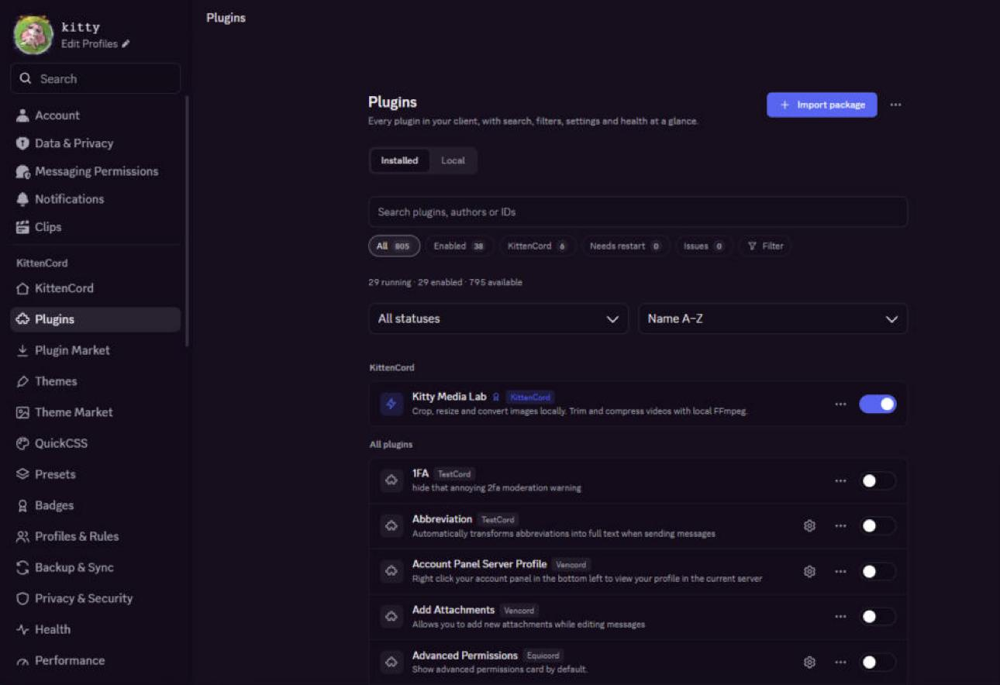

# KittenCord

The cutest Discord client mod

## Features

- Easy to install
- 800+ built in plugins from Vencord, Equicord, TestCord and KittenCord
- Its own settings section with a list or card view for plugins
- Theme Library and Snippet Library built into the Themes page
- Plugin Studio: write and test your own plugins inside Discord
- KittenCord badges, while Vencord, Equicord and TestCord badges keep showing
- Safe Start: if a plugin stops Discord from starting, only that plugin is turned off
- Original plugins: Media Lab, Mini Dock, Time Capsule and Voice Log

## Installing / Uninstalling

Download `KittencordSetup.exe` from https://github.com/xtufa7/KittenCord/releases/latest

## Join our Support/Community Server

https://discord.gg/7bZ5qKdDR

## Disclaimer

Discord is trademark of Discord Inc. and solely mentioned for the sake of descriptivity.
Mention of it does not imply any affiliation with or endorsement by Discord Inc.

Using KittenCord violates Discord's terms of service

Client modifications are against Discord's Terms of Service.

However, Discord is pretty indifferent about them and there are no known cases of users getting banned for using client mods. So you should generally be fine if you don't use plugins that implement abusive behaviour.

Regardless, if your account is very important to you and it getting disabled would be a disaster for you, you should probably not use any client mods (not exclusive to KittenCord), just to be safe.

